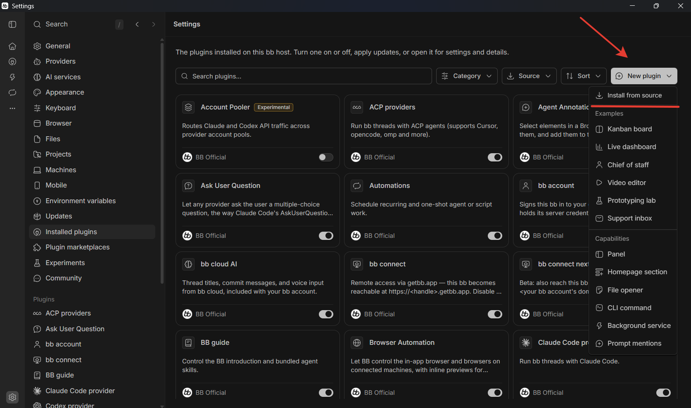
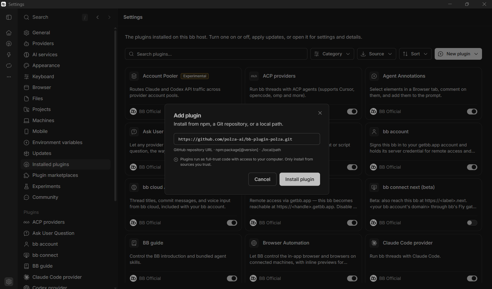
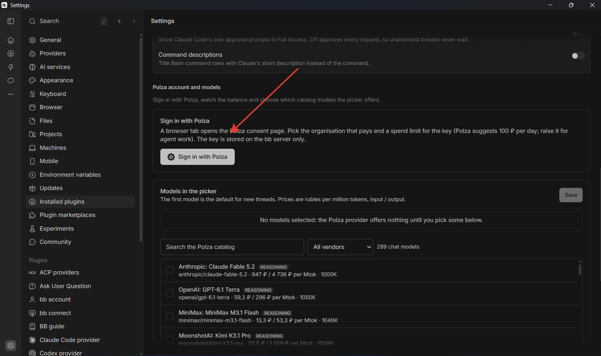
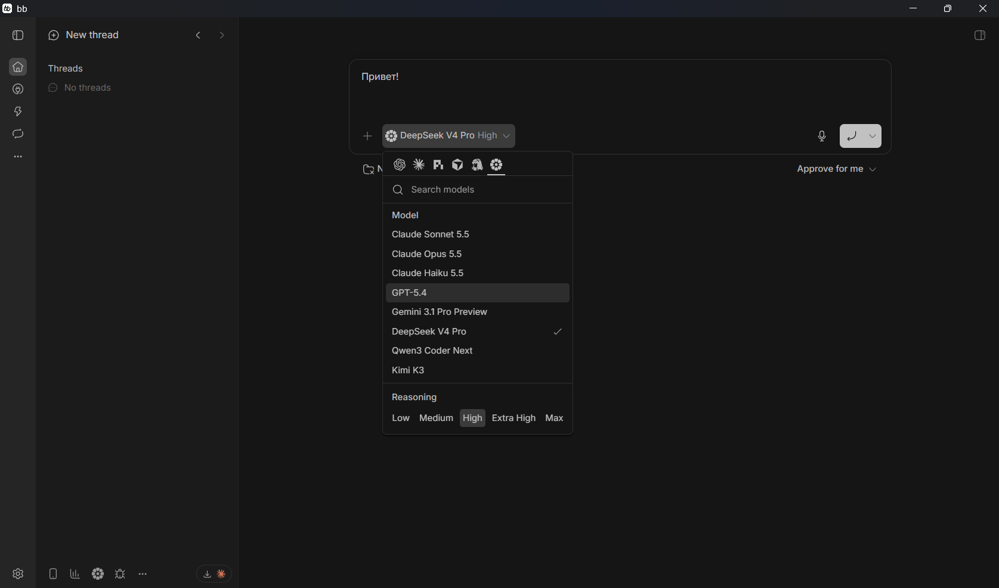
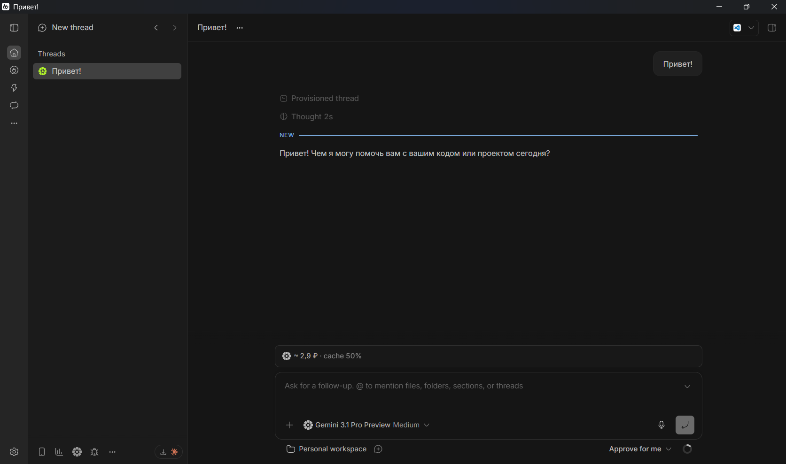
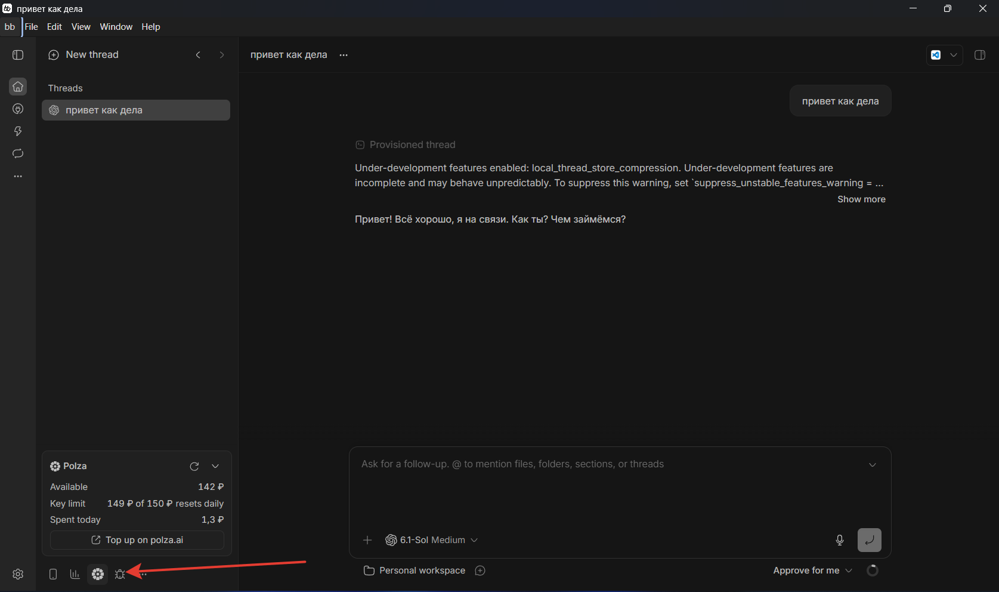

[bb](https://getbb.app/) — приложение для работы с AI-агентами. Плагин [Polza.ai](https://github.com/polza-ai/bb-plugin-polza) добавляет модели Polza.ai в список моделей bb и показывает расходы прямо в приложении.

## Что понадобится

- Установленное приложение bb для вашей операционной системы.
- Аккаунт Polza.ai для авторизации в плагине.

## Установка и подключение

<Steps>
  <Step title="Установите и запустите bb">
    Откройте [getbb.app](https://getbb.app/), выберите версию для своей ОС, установите и запустите приложение.
  </Step>

  <Step title="Откройте установку плагина">
    В bb перейдите в **Settings → Installed plugins**. Нажмите **New plugin → Install from source**.

    <Frame>
      
    </Frame>
  </Step>

  <Step title="Установите плагин Polza.ai">
    В открывшемся окне вставьте ссылку на репозиторий плагина и нажмите **Install plugin**:

    ```text
    https://github.com/polza-ai/bb-plugin-polza.git
    ```

    <Frame>
      
    </Frame>
  </Step>

  <Step title="Авторизуйтесь через Polza.ai">
    После установки откройте настройки плагина **Polza** и нажмите **Sign in with Polza**. В браузере подтвердите вход на Polza.ai и выберите организацию, которая будет оплачивать запросы.

    <Frame>
      
    </Frame>
  </Step>

  <Step title="Настройте и выберите модель">
    В настройках плагина отметьте нужные модели из каталога Polza.ai и нажмите **Save**. Затем откройте чат bb и выберите одну из добавленных моделей в меню возле поля ввода.

    <Frame>
      
    </Frame>
  </Step>

  <Step title="Отправьте тестовый запрос">
    Напишите модели короткий запрос, например «Привет!». Если ответ появился в чате, подключение работает.

    <Frame>
      
    </Frame>
  </Step>

  <Step title="Проверьте виджет Polza.ai">
    В нижней части боковой панели bb доступен виджет **Polza**. Он показывает доступный остаток, лимит ключа и сумму, потраченную сегодня.

    <Frame>
      
    </Frame>
  </Step>
</Steps>

Если при подключении возникнут вопросы, напишите в [поддержку Polza.ai](/glavnoe/support).

## Следующие шаги

<CardGroup cols={2}>
  <Card title="Выбор провайдера" icon="server" href="/gaidy/provider-selection">
    Как выбирать и переключать провайдеров моделей Polza.ai
  </Card>
  <Card title="Алиасы параметров" icon="microchip" href="/osobennosti/aliases">
    Как указывать настройки маршрутизации в строке `model` для chat-style API
  </Card>
</CardGroup>
